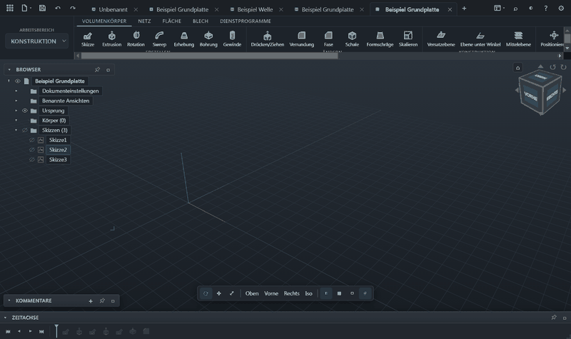
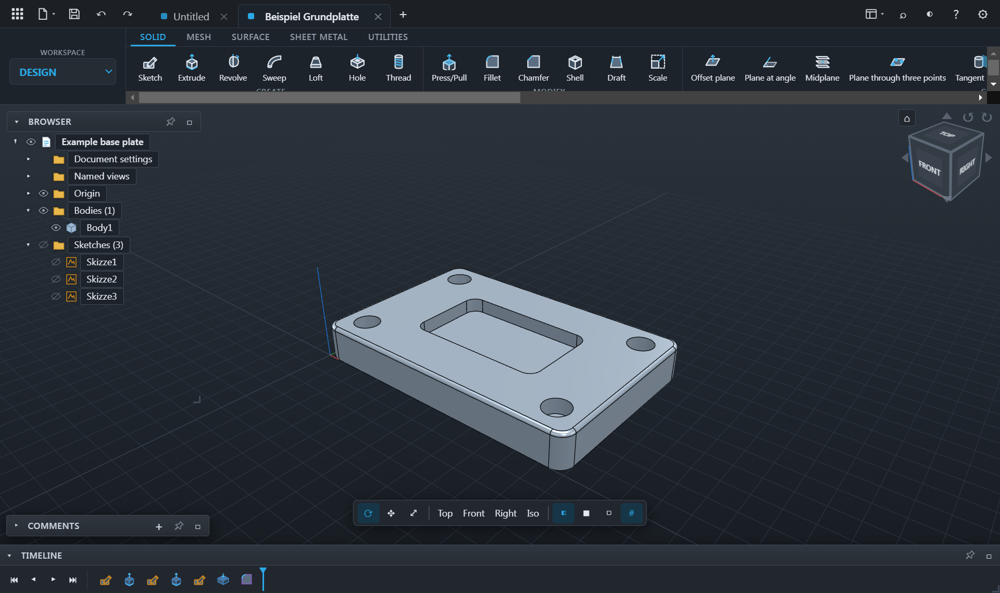
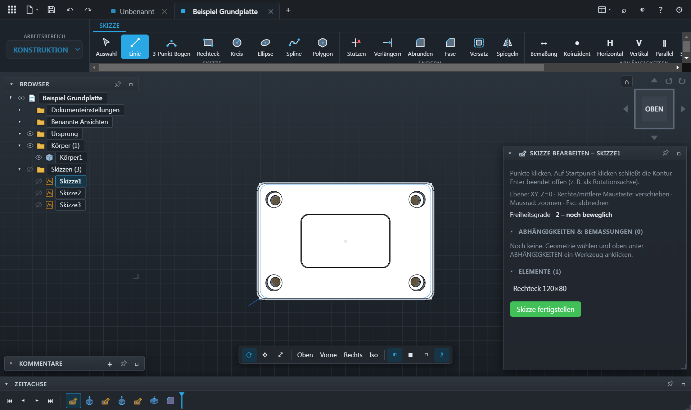
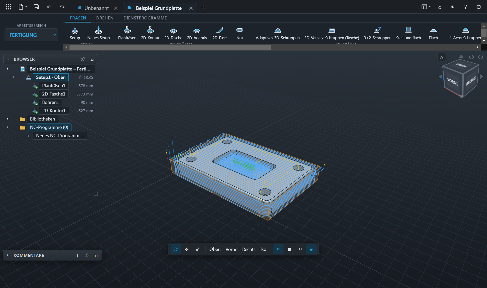
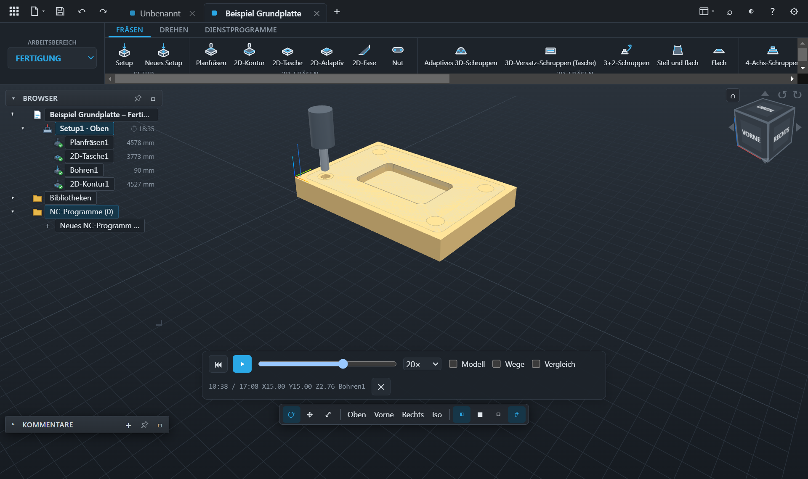
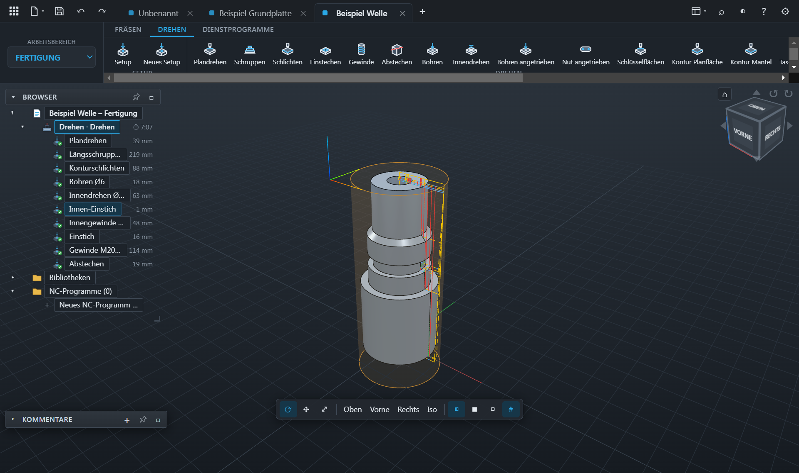
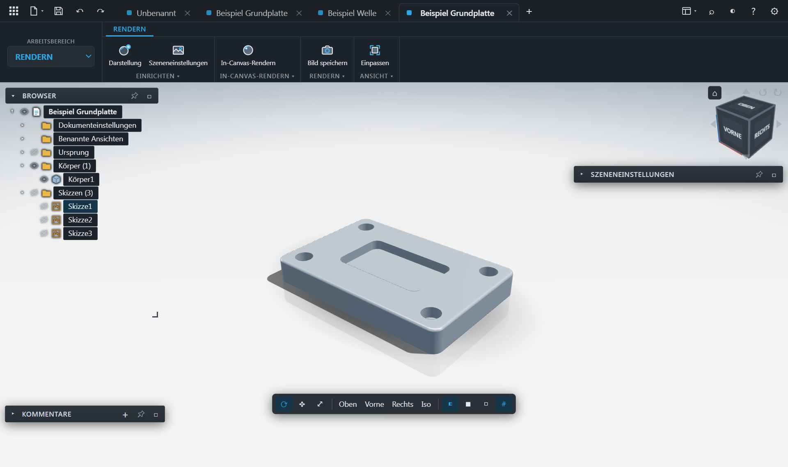

# OpenFab

**CAD/CAM für Konstruktion und Fertigung – komplett offline, im Browser oder als Windows-App.**

OpenFab ist ein parametrisches 3D-CAD mit integriertem CAM. Teile werden über Skizzen und eine Feature-Zeitachse konstruiert. Danach lassen sich Baugruppen, Zeichnungen und Renderings erstellen und NC-Programme für Fräs- und Drehmaschinen erzeugen, simulieren und prüfen. Alles läuft lokal: kein Konto, keine Cloud, keine Telemetrie.

> **Status: Release Candidate 2 (v1.0.0-rc.2).** Der Funktionsumfang ist vollständig für 1.0. Bitte NC-Programme vor dem ersten Einsatz an der Maschine immer im Probelauf prüfen (siehe [Grenzen](#bekannte-grenzen)).



*Von der Skizze zum fertigen Teil: Konstruktion Schritt für Schritt, danach Werkzeugwege und Simulation.*

---

## Bilder

| Konstruktion | Skizze |
|---|---|
|  |  |
| **Fertigung: Werkzeugwege** | **Simulation mit Materialabtrag** |
|  |  |
| **Drehen** | **Rendern** |
|  |  |

---

## Funktionen

### Konstruktion (CAD)
- **Skizzen** mit Linie, Rechteck (2 Punkte, Mitte, 3 Punkte), Kreis (Mitte, 2 Punkte, 3 Punkte), Bögen (3 Punkte, Mittelpunkt, tangential), Langloch, Polygon, Text und Konstruktionslinien
- **Geometrischer Solver** mit Bemaßungen und Abhängigkeiten (tangential, konzentrisch, gleich … auch an Bögen)
- **Stutzen und Verlängern**: Abhängigkeiten und Bemaßungen bleiben dabei erhalten
- **Abrunden, Fase und Versatz** als Klick-Werkzeuge mit Vorschau am Mauszeiger
- **Volumenkörper**: Extrusion, Rotation, Sweep, Loft, Rohr, Spirale, Rippe, Drücken/Ziehen, Bohrung (auch als Gewindebohrung), Gewinde, Verrundung, Fase, Formschräge, Wandung, Aufdicken, Prägen (eben oder auf Zylinder gewickelt), Kombinieren, Teilen, Skalieren
- **Muster**: rechteckig, kreisförmig und entlang eines Pfades; Spiegeln
- **Konstruktionsgeometrie**: Ebenen (versetzt, unter Winkel, durch 3 Punkte, tangential), Achsen und Punkte
- **Flächen**: Extrusion, Rotation, Loft, Pflaster, Versatz, Vernähen, Trennen, Verlängern, Füllen
- **Blech**: Laschen, Lasche an Lasche (U-Falz, Z-Stufe, 180°-Umschlag), offene oder geschlossene Ecken mit Eckfreistellung (rund oder eckig), Abwicklung mit Biegetabelle
- **Zeitachse** mit Zwischenspeicher: Änderungen berechnen nur die betroffenen Features neu, mit schrittweiser Berechnung und Fortschrittsanzeige

### Baugruppen
- Gelenke: starr, Dreh-, Schiebe-, Zylinder-, Kugel- und Ebenengelenk
- Gelenkursprünge, Grenzen, Kontaktstopp, gekoppelte Bewegungen, Bewegungsstudie
- Kollisionsprüfung zwischen Körpern

### Zeichnung
- Normalansichten, Isometrie, Schnitt A–A und Detailansicht; Mittellinien an Wellen, Zapfen und Bohrungen
- Eigene Maße (linear, Durchmesser, Radius, Winkel) mit Toleranz-/Passungszusatz, Hinweise mit Pfeil, Oberflächenzeichen, Form- und Lagetoleranzen mit Bezügen, Gewinde- und Fasenangaben, Positionsnummern, Stückliste, Schriftfeld
- Export als SVG, Drucken bzw. Speichern als PDF

### Rendern
- Studioumgebungen, Belichtung, Bodenschatten und Spiegelung
- Progressive Kantenglättung, Tiefenschärfe, PNG-Export
- Darstellungen per Drag-and-Drop auf Körper ziehen

### Fertigung (CAM)
- **Einrichtungen** mit Rohteil (Quader, Zylinder, Restmaterial aus der vorigen Aufspannung), Nullpunkt, Spannmitteln und 3+2-Schwenkung
- **2D-Fräsen**: Planen, Kontur, Tasche, 2D-Adaptiv, Nut, Gravur, Fase/Entgraten, Bohren, Gewindefräsen, Zirkularfräsen, Antasten
- **3D-Fräsen**: Adaptiv-Schruppen, Parallel, Kontur (Z-Ebenen), Spirale, Radial, Morph, Geodätisch, Scallop, Planflächen, Restmaterial in Ecken und weitere
- **4-Achs-Simultan**: Rotation (Helix/Linien), 4-Achs-Schruppen, Abwickeln von Skizzen auf den Zylinder
- **Drehen**: Plandrehen, Schruppen/Schlichten (mit Schneidenradius-Kompensation), Einstechen, Gewinde, Abstechen, Bohren in der Drehachse, Innendrehen, Innen-Einstiche und Innengewinde; mit angetriebenem Werkzeug und C-Achse: Bohren (axial auf dem Lochkreis, radial als Querbohrung), Passfedernuten, Schlüsselflächen (Zweiflach, Vierkant, Sechskant) freie Skizzenkonturen auf der Planfläche oder abgewickelt auf dem Umfang und Taschen in der Planfläche
- **Werkzeugbibliothek** mit Schnittdaten-Rechner, Werkstoff-Sätzen, Standzeit und Halterdarstellung
- **Simulation** mit Materialabtrag (auch auf Zylinder-Rohteilen), Vergleich mit dem Fertigteil (Rest / zu tief), Bearbeitungszeit je Aufspannung
- **NC-Editor** mit Backplot, Suche und Bearbeiten; die **NC-Prüfung** erkennt Kollisionen von Halter, Schaft und Eilgang, Spannmittel- und Tischkontakt, Achsgrenzen und Syntaxfehler (Heidenhain)
- **Postprozessoren**: Heidenhain Klartext (inkl. APPR/DEP, Zyklen 2xx, Lochmuster 220/221), Fanuc, Sinumerik, Okuma (Fräsen/Drehen), LinuxCNC, GRBL und weitere. Eigene Postprozessoren lassen sich im integrierten Editor mit Live-Vorschau anpassen.
- **Steuerungszyklen** statt ausgerechneter Bahnen: Bohr- und Taschenzyklen, Zapfen, Lochkreise und -raster, Dreh-Schruppzyklus und Gewindezyklus

### Bedienung
- Markierungsmenü (Rechtsklick), ViewCube, Tastenkürzel (z. B. Q Drücken/Ziehen, F Verrundung, M Verschieben, I Messen, X Konstruktionslinie)
- Mehrere Dokumente in Tabs, Versionsstände beim Speichern; Import von STEP, IGES, STL, OBJ und DXF, Werkzeugbibliotheken und Postprozessoren (.cps)

---

## Starten

### Windows-App
Lade `OpenFab-<Version>-windows-x64.zip` aus den [Releases](../../releases), entpacke das Archiv und starte `OpenFab.exe`.

### Browser-Version (offline-fähig)
Lade `OpenFab-<Version>-browser.zip` aus den [Releases](../../releases) und entpacke es. Dann im Ordner einen lokalen Webserver starten, zum Beispiel:

```bash
python -m http.server 8765
```

und `http://localhost:8765` öffnen. Nach dem ersten Laden funktioniert die App auch ohne Netzwerk (Service Worker). Hinweise dazu stehen in `LIESMICH.txt` im Archiv.

### Aus dem Quellcode
Voraussetzungen: [Node.js](https://nodejs.org) 18 oder neuer. Für die Browser-Variante zusätzlich Python 3 (oder ein anderer statischer Webserver).

```bash
npm install
```

```bash
npm start
```

startet die Electron-App. Alternativ startet `start.bat` einen lokalen Webserver und öffnet OpenFab im Browser.

---

## Bauen

| Befehl | Ergebnis |
|---|---|
| `npm run build` bzw. `build-exe.bat` | Windows-App in `dist/OpenFab-win32-x64` |
| `npm run build:web` bzw. `build-web.bat` | Browser-Version in `dist/OpenFab-Browser` (+ ZIP über die .bat) |
| `npm run build:kernel` | Rust-Kern nach WebAssembly (`vendor/openfab-kernel`), benötigt Rust + `wasm32-unknown-unknown` |

## Tests

Alle Tests auf einmal:

```bash
npm test
```

| Befehl | Prüft |
|---|---|
| `npm run test:trim` | Skizze: Stutzen und Verlängern |
| `npm run test:sketch` | Skizzenwerkzeuge (Rechtecke, Kreise, Bögen) |
| `npm run test:solver` | Abhängigkeiten und Bemaßungen an Bögen |
| `npm run test:kernel` | Rust-Kern (WebAssembly) |
| `npm run test:cam` | Alle Frässtrategien an einem Prüfteil mit exakt bekannter Form: keine Verletzung von Teil und Aufmaß (Toleranz Schlichten 0,02 mm, Schruppen 0,04 mm); alle Postprozessoren (gültige Werte, Programmrahmen, zurückgelesene Positionen = Bahn); alle Drehoperationen und Dreh-Posts, Schneide gegen Kontur, Schrupp-/Schlichtzyklus G71/G70 und G85/G87; Lochmuster und Bohrreihenfolge |
| `npm run test:hh` | Heidenhain Klartext: ein Programm mit allen Zyklen, APPR/DEP, Schraubenlinien, Tastzyklus und geschwenkter Aufspannung in sechs Optionskombinationen, Satz für Satz gegen die Klartext-Regeln und den Zustand der Steuerung geprüft |
| `npm run test:iso` | G-Code für Fanuc/ISO, Okuma OSP-M, LinuxCNC, GRBL und Sinumerik: dasselbe Programm in fünf Optionskombinationen, Satz für Satz geprüft (Längenkorrektur, Spindel, Vorschub, Zyklen, Kreisbögen) |
| `npm run test:lathe` | Drehprogramme für Fanuc, Okuma und LinuxCNC: alle Operationen als Bahn und als Zyklen, Satz für Satz geprüft (Werkzeugwechsel abseits des Teils, Spindel, C-Achse, Zyklen mit Kontur) |
| `npm run test:drawing` | Zeichnung: eigene Maße, Winkelmaße, Hinweise und Maßzusätze im erzeugten SVG |

Die Tests laufen ohne Browser in Node.js und bei jedem Push automatisch auf GitHub.

### Neue Version veröffentlichen

1. Version in `package.json` setzen (z. B. `1.0.0`) und `CHANGELOG.md` ergänzen.
2. Committen, Tag setzen und hochladen:

```bash
git tag v1.0.0
```

```bash
git push origin main --tags
```

Der Workflow **Release** (`.github/workflows/release.yml`) testet, baut die Windows-App und die Browser-Version und hängt beide als ZIP an den GitHub-Release. Tags mit Bindestrich (z. B. `v1.0.0-rc.2`) werden als Vorabversion veröffentlicht. Bei jedem Push auf `main` laufen außerdem die Tests (`.github/workflows/ci.yml`).

---

## Aufbau

| Ordner | Inhalt |
|---|---|
| `js/` | Anwendung (ES-Module, ohne Bundler): Modell, Skizze, Solver, CAM, Simulation, Postprozessoren, Oberfläche |
| `css/`, `icons/` | Oberfläche und Symbole |
| `electron/` | Hülle für die Windows-App |
| `vendor/` | Mitgelieferte Bibliotheken (OpenCascade/replicad, three.js, Clipper, opentype.js …) |
| `rust/openfab-kernel/` | Experimenteller eigener Geometriekern in Rust (truck), als WebAssembly eingebunden |
| `tools/` | Build- und Testskripte |

Standardmäßig rechnet OpenFab mit **OpenCascade** (über replicad/WebAssembly). Der Rust-Kern ist eine experimentelle Alternative, die über die Kern-Schnittstelle umgeschaltet werden kann.

---

## Bekannte Grenzen

- **NC-Programme immer erst im Probelauf testen.** Die Okuma-Syntax (Fräsen und Drehen, inkl. G85/G81-Zyklen) wurde nach allgemeinem Wissen umgesetzt und nicht an einer echten Steuerung geprüft.
- Kein simultanes 5-Achs-Fräsen. Unterstützt werden 3+2 (geschwenkte Aufspannungen) und 4-Achs-Simultan um die A-Achse.
- Angetriebene Werkzeuge an der Drehmaschine: Bohren, Nuten, Flächen und Skizzenkonturen auf Planfläche und Umfang; keine Y-Achse, Taschen nur auf der Planfläche. Polar- und Zylinder-Interpolation (G12.1, G7.1) nur im Fanuc-Postprozessor, sonst kurze X/C-Schritte bzw. Z/C ohne Interpolation. In der Simulation erscheinen Konturen als Bänder, nicht als Materialabtrag. Die M-Codes für C-Achse und Werkzeugspindel sind maschinenabhängig und müssen im Postprozessor geprüft werden. Die NC-Prüfung rechnet angetriebene Bearbeitungen nicht gegen das Rohteil.
- Keine Freiform-/T-Spline-Modellierung.
- Große 3D-Strategien (Adaptiv 3D, Geodätisch) brauchen je nach Teil mehrere Sekunden Rechenzeit.

---

## Lizenz

OpenFab steht unter der **GNU General Public License v3.0 oder später**, siehe [LICENSE](LICENSE).

Mitgelieferte Bibliotheken stehen unter ihren eigenen Lizenzen, siehe [THIRD_PARTY_NOTICES.md](THIRD_PARTY_NOTICES.md).

---

## Unterstützen

OpenFab ist kostenlos und entsteht in der Freizeit. Wenn dir das Programm hilft, freue ich mich über einen Kaffee:

<a href="https://www.paypal.com/donate/?business=vbleich%40gmail.com&currency_code=EUR&item_name=OpenFab"></a>
